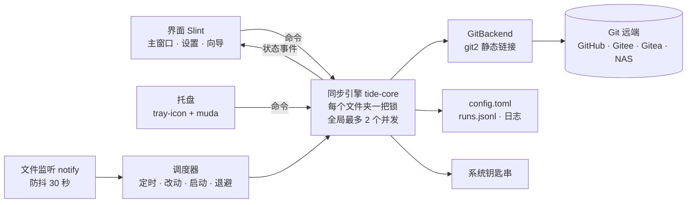

# Tide 设计规格

- 日期：2026-10-18
- 状态：草案，待拍板（见文末“待拍板”）
- 范围：只做设计，不含实现
- 关联：界面样机 [docs/design/tide-design.html](../design/tide-design.html)

Tide（暂定名）是一个常驻托盘的小程序。用户指定几个本地文件夹，它把每个文件夹接到一个 Git 远端上，定时或在改动后自动同步，所有版本都留在历史里，覆盖和回滚都能撤销。主要用于同步文档。

## 1. 目标与边界

**要做**

- 多个同步文件夹，每个的本地位置、远端、分支、规则都可自定义
- 定时同步、改动后自动同步、立即同步（单个或全部）
- 增量：只扫改动文件，只传差异对象
- 历史：按时间和设备浏览，查看差异，恢复单个文件或整个文件夹
- 覆盖：本地覆盖远端、远端覆盖本地，均可撤销
- 同步文件夹的增删改查；托盘常驻；深色界面（跟随系统 / 浅 / 深）

**不做**

- 通用 Git 客户端：没有分支管理、暂存区、交互式 diff 编辑
- 实时协同编辑、移动端
- 自建服务器：任何 Git 远端都行（GitHub、Gitee、自建 Gitea、NAS 上的裸仓库）
- 首版不支持 Git LFS（见待拍板）

### 资源目标（设计目标，未实测，M4 实测后回填）

| 指标 | 目标 | 靠什么达到 |
|---|---|---|
| 安装包 | ≤ 15 MB | 单个可执行文件；libgit2 静态链接；不打包 WebView 和运行时；用系统字体 |
| 托盘常驻内存 | ≤ 30 MB | 关窗口时销毁窗口组件，释放渲染资源，只留引擎；历史分页懒加载，不缓存文件内容 |
| 窗口打开时内存 | ≤ 80 MB | Slint 渲染器；列表虚拟化 |
| 空闲 CPU | ≈ 0 | 不轮询：文件监听是系统事件，调度线程睡到下一个到期时间 |
| 无改动时一轮同步 | 本地检查 < 1 秒（1 万个文件） | 监听器标脏，只在脏或到期时跑 status；网络只做一次 fetch |

## 2. 技术选型

### 界面框架

内存量级是同类应用的经验估计，不是本项目实测。

| 方案 | 语言 | 常驻内存量级 | 观感 | 结论 |
|---|---|---|---|---|
| **Slint** | Rust + `.slint` 声明式 | 低，十几到几十 MB | 自带 Fluent 深色样式，可完全自绘 | **推荐** |
| iced | 纯 Rust，Elm 架构 | 中，wgpu 默认；可换软件渲染 | 现代，组件要自己补 | 备选 |
| egui | 纯 Rust，即时模式 | 低 | 工具感强，难做精致 | 只适合调试面板 |
| Tauri 2 | Rust + Web 前端 | 高，多一个 WebView 进程 | 最灵活 | 不满足纯 Rust 和小占用 |
| Avalonia（.NET NativeAOT） | C# | 中高 | Fluent 成熟 | 团队更想写 C# 时再考虑 |

选 Slint 的理由：`.slint` 写法和 QML 很像（属性绑定、组件、状态），团队上手成本最低；界面描述编译进二进制。许可证对桌面应用有免版税条款，要求在“关于”里标注 Slint，开工前核对条款原文。

### Git 引擎

| 方案 | 情况 | 结论 |
|---|---|---|
| **`git2`**（libgit2，vendored 静态链接） | clone、fetch、push、合并、文件级三方合并、SSH 和 HTTPS 都成熟；用户机器不需要装 Git | **首版用它** |
| `gix`（gitoxide，纯 Rust） | 读、status、fetch 很快；push 尚未完成（开工时复查） | 藏在接口后，push 成熟后可替换 |
| 调用系统 `git` | 兼容性最好（凭据助手、LFS），但依赖用户安装、要解析输出 | 可选后端，用于 LFS 等场景 |

libgit2 是 C 库，Git 这一层做不到 100% 纯 Rust；它静态编进同一个可执行文件，用户无感。引擎通过 `GitBackend` 接口调用，换 gix 不动上层。

### 其余依赖

| 用途 | crate | 说明 |
|---|---|---|
| 托盘与菜单 | `tray-icon` + `muda` | Windows、macOS 在主线程；Linux 需要单独 GTK 线程 |
| 文件监听 | `notify` + `notify-debouncer-full` | 系统事件驱动，防抖合并 |
| 凭据 | `keyring` | 令牌存系统钥匙串，不写进配置文件 |
| 配置与目录 | `serde` + `toml`，`directories` | 人能直接读改的 `config.toml` |
| 日志 | `tracing` + `tracing-appender` | 按天滚动，保留 7 天，日志内容英文 |
| 线程通信 | `crossbeam-channel` | 不引入 tokio：git2 是阻塞调用 |
| 系统集成 | `auto-launch`、`notify-rust`、`rfd`、`single-instance` | 开机启动、系统通知、原生选文件夹、单实例 |

## 3. 架构



工程结构：

```
tide/
  crates/
    tide-core/   配置、同步引擎、调度、监听；不依赖界面，可单独测试
    tide-git/    GitBackend 接口 + git2 实现
    tide-app/    Slint 界面、托盘、通知、开机启动、单实例
  ui/            *.slint 界面文件与设计 token
```

线程模型：

- 主线程：Slint 事件循环；Windows、macOS 的托盘也在这里
- 调度线程：维护每个文件夹的下次到期时间，睡到最近一个
- 同步工作线程 ×2：执行同步，结果经通道回传，界面用 `invoke_from_event_loop` 刷新
- 监听线程：notify 内部线程，只给文件夹标脏
- Linux 托盘线程：GTK 主循环

## 4. 文件夹与自定义位置

“同步文件夹”是唯一的核心对象，界面上的增删改查都围绕它。数量不限，每个可单独设置：

| 项 | 可选值 | 默认 |
|---|---|---|
| 本地位置 | 任意路径：其他盘符、移动硬盘、网络共享（网络共享提示冲突风险） | 用户选 |
| 历史数据位置 | 文件夹内 `.git`；或集中放到自定义目录，文件夹里不留隐藏目录 | 文件夹内 |
| 远端 | SSH 或 HTTPS；同一远端仓库可给多个本地文件夹用，各用一个分支 | — |
| 备份远端 | 零到多个，只推送不拉取 | 无 |
| 认证 | SSH 密钥 / 访问令牌 / 系统 Git 凭据助手 | 按地址自动猜 |
| 同步时机 | 每 5 / 15 / 30 / 60 分钟或自定义；改动后；启动时；只手动 | 每 15 分钟 + 改动后 |
| 冲突策略 | 两份都保留 / 本地优先 / 远端优先 / 每次问我 | 两份都保留 |
| 忽略规则 | 预设（Office 临时文件、系统文件）+ 自定义，`.gitignore` 语法 | 预设开启 |
| 大文件 | 超阈值提醒或不收录 | 50 MB 提醒，100 MB 不收录 |

校验：同步文件夹不能互相嵌套；同一本地路径不能加两次；同一远端同一分支被两个文件夹使用时提醒。

配置样例：

```toml
[app]
device_name   = "办公室台式机"    # 写进每次提交，历史里按设备显示
theme         = "system"          # system | light | dark
close_to_tray = true
autostart     = true
notify        = "errors"          # errors | every | off
max_parallel  = 2

[[folder]]
id         = "f-7c2a"
name       = "读书笔记"
path       = 'D:\notes'
git_dir    = ""                   # 空 = 文件夹内 .git；也可写 'E:\tide-history\notes.git'
remote     = "git@github.com:me/notes.git"
branch     = "main"
mirrors    = ["git@gitee.com:me/notes.git"]   # 备份远端，只推送
auth       = { kind = "ssh", key = '~/.ssh/id_ed25519' }  # 令牌类凭据只存在系统钥匙串
interval   = "15m"
on_change  = true
debounce   = "30s"
conflict   = "keep_both"          # keep_both | prefer_local | prefer_remote | ask
ignore     = ["~$*", "*.tmp", ".~lock.*#", ".DS_Store", "Thumbs.db", "desktop.ini"]
large_file = { warn = "50MB", reject = "100MB" }
paused     = false
```

程序给自己管理的仓库固定设置：`core.autocrlf=false`（文档按原样字节保存）、Windows 上 `core.longpaths=true`、macOS 上 `core.precomposeunicode=true`（避免中文文件名跨平台变成两个文件）。

## 5. 同步算法

两条底线：不丢任何一个版本；不往文档里写 `<<<<<<<` 冲突标记。因此不用 rebase 或带冲突标记的 merge，按文件做三方对账，自己生成合并结果。

### 一轮同步（单个文件夹，持有该文件夹的锁）

1. **收集**：工作区改动写入索引，只收修改时间稳定 2 秒的文件。有改动就提交本地快照 `L`，作者是设备名。
2. **护栏**：文件夹根目录不存在，或本次删除超过 50 个且超过 30% 的文件，立即暂停该文件夹并提示。
3. **拉取**：fetch 远端分支得到 `R`。
4. **对账**：`B = merge-base(L, R)`。`R = B` 直接推送；`L = B` 快进到 `R`；否则按下表逐文件决定，生成合并提交 `M`（父提交 `R`、`L`）。
5. **写回**：只写回内容变了的文件，先写临时文件再改名；写前核对哈希，用户这期间又改了的文件本轮不覆盖，下一轮重新对账。
6. **推送**：push 到远端，再推备份远端。被拒就回到第 3 步，最多 3 次。
7. **收尾**：推送成功后才移动 `refs/tide/synced`，写运行记录，刷新界面与托盘。中途崩溃，下次从第 1 步重来。

### 逐文件对账表

| 本地（B→L） | 远端（B→R） | 结果 |
|---|---|---|
| 没变 | 增 / 改 / 删 | 用远端 |
| 增 / 改 / 删 | 没变 | 用本地 |
| 两边改成同样内容 | | 不算冲突 |
| 改（文本） | 改（文本） | 三方合并；不重叠自动合好，重叠按冲突策略 |
| 改（docx、pdf、图片等） | 改 | 按冲突策略 |
| 删 | 改 | 保留改过的文件 |
| 改 | 删 | 保留改过的文件 |
| 两边新建同名、内容不同 | | 按冲突策略 |

文本文件按扩展名白名单：`md txt org rst tex csv`，可在设置里加。

### 冲突策略

| 策略 | 做法 |
|---|---|
| 两份都保留（默认） | 原位置放远端版本，本地版本另存为 `书单 (冲突 · 笔记本 · 10-18 14.30).md`，通知一次 |
| 本地优先 / 远端优先 | 直接用一边；另一边在“历史 → 被替换的版本”可找回 |
| 每次问我 | 该文件停在“冲突”页等选，其余文件照常同步 |

### 首次关联

| 本地 | 远端 | 首次同步 |
|---|---|---|
| 有文件，非仓库 | 空仓库 | 初始化并上传；先告知文件数与大小 |
| 空文件夹 | 有内容 | 克隆 |
| 有文件 | 有内容 | 按“两边都新增”对账，冲突一律两份都保留；先预览，确认后才动 |
| 已是 Git 仓库 | — | 直接接管，读取已有远端和分支，不改历史 |

## 6. 覆盖与历史

所有覆盖和恢复都是追加新提交，不改写历史，不 force push，因此都能撤销；界面用“撤销”代替层层确认，只有删数据才二次确认。

| 操作 | 实际做什么 | 怎么撤销 |
|---|---|---|
| 用本地覆盖远端 | 在远端最新提交上提交“内容 = 本地”的新提交并推送 | 历史里恢复覆盖前那一刻 |
| 用远端覆盖本地 | 先把未同步改动存成 `refs/tide/replaced/<时间>`，再把文件夹变成远端最新 | 历史 → 被替换的版本 → 恢复 |
| 恢复单个文件 | 改回选中版本，作为普通改动同步 | 再恢复一次 |
| 恢复整个文件夹到某一刻 | 新提交，内容 = 那一刻的文件树 | 同上 |
| 另存为 | 导出某个版本到指定位置 | — |
| 移除同步文件夹 | 默认只从 Tide 移除；勾选才删除历史数据，文档本身永远不删 | 删除历史不可撤销，二次确认 |

历史按时间倒序、按天分组，每条显示时间、设备、改动数。自动合并提交折叠成一行，发生过冲突的才展开。每次加载 50 条。

## 7. 状态与调度

| 状态 | 含义 |
|---|---|
| 已同步 | 本地和远端一致 |
| 有改动 | 本地有改动，等下一轮 |
| 同步中 | 收集 → 拉取 → 对账 → 写回 → 推送，界面显示当前阶段 |
| 有冲突 | “每次问我”策略下有文件待选 |
| 离线 | 连不上远端；改动安全存在本地 |
| 出错 | 认证失败、护栏触发、找不到文件夹等 |
| 已暂停 | 用户暂停或护栏自动暂停 |

托盘图标取最严重的：出错 > 有冲突 > 同步中 > 有改动 > 离线 > 已暂停 > 已同步；原因写在悬停提示。

调度规则：

- 每个文件夹有自己的下次到期时间，调度线程睡到最近一个
- 文件改动防抖 30 秒，连续改动顺延，最多顺延 5 分钟
- 启动 10 秒后、睡眠唤醒后各跑一轮
- 失败退避 1、2、4、8……最长 30 分钟；认证失败不自动重试
- 同步中再点“立即同步”：记“结束后再来一轮”，不重复排队

日志：每轮一个 `run_id`，开始与结束成对，带耗时；失败记录阶段和原因。运行记录写 `runs.jsonl`（保留最近 1000 轮）。

```
2026-10-18T14:30:01Z INFO  sync.start  folder=f-7c2a run=r-0192 trigger=change dirty=3
2026-10-18T14:30:03Z INFO  sync.finish folder=f-7c2a run=r-0192 pushed=3 pulled=1 conflicts=0 elapsed_ms=1840
2026-10-18T15:02:11Z WARN  sync.fail   folder=f-91b0 run=r-0193 phase=fetch error="authentication required" next_retry=none
```

## 8. 界面

视觉按 Linear 现行风格：近黑底、1px 发丝线、白色低透明叠层，彩色只在小状态图标；强调色偏海水青。键盘操作零动画，悬停只做 100ms 颜色变化，同步图标只在真的传数据时转。浅色主题同结构换 token。样机见 [tide-design.html](../design/tide-design.html)。

页面：

| 页面 | 内容 |
|---|---|
| 主窗口 | 左栏文件夹列表（状态形状 + 颜色双编码）；右侧一句话状态 + 标签页：改动 / 历史 / 冲突 / 规则 / 同步记录 |
| 历史 | 按天分组，每台设备一个固定色点；文本给行级差异，二进制给另存为 |
| 添加向导 | 本地文件夹 → 远端仓库 → 同步规则；“测试连接”同时探测首次同步会发生什么 |
| 确认框 | 可撤销的替换用普通主按钮；只有删除历史才用红色 |
| 护栏提示 | 第一句先说“远端没有任何变化” |
| 托盘 | 左键开窗口；右键菜单首行是当前状态；暂停子菜单 30 分钟 / 1 小时 / 直到恢复 |
| 全局设置 | 外观、开机启动、关窗留托盘、通知、设备名、凭据管理、并发数、日志目录、关于 |

键盘（macOS 上 Ctrl 换 Cmd）：`Ctrl R` 同步当前；`Ctrl Shift R` 同步全部；`Ctrl N` 添加；`↑ ↓` 切文件夹；`Ctrl 1–5` 切标签；`Ctrl F` 查找；`Esc` 关对话框 / 收回托盘。

文案：

| 场景 | 文案 |
|---|---|
| 托盘悬停（正常） | 全部同步好了 · 14:30 |
| 离线 | 现在连不上 github.com。改动都存在本地，联网后会自动补上。 |
| 认证失败 | GitHub 拒绝了访问令牌，可能已经过期。更新凭据后会马上重试。 |
| 冲突 | 书单.md 在两台电脑上都改过。两份都留下了：远端版本在原位，你这台的在“书单 (冲突 · 笔记本 · 10-18 14.30).md”。 |
| 文件被占用 | 读书会议程.docx 正在被 Word 使用，关掉后下一轮会同步。 |
| 找不到文件夹 | 找不到 E:\合同扫描件，可能是移动硬盘没插。已暂停，插上后点“继续同步”。 |
| 首次同步完成（仅一次） | 第一次同步完成，128 个文件已经在远端了。之后的改动会自己跟上。 |

## 9. 异常处理

| 情况 | 处理 | 用户看到 |
|---|---|---|
| 网络不通、超时 | 进入离线，按退避重试，不弹通知 | 托盘灰色，悬停写原因 |
| 认证失败 | 停止自动重试 | 通知一次 +“更新凭据” |
| 推送被拒 | 重新拉取、对账、推送，最多 3 次 | 3 次都失败才提示 |
| 远端仓库或分支不存在 | 出错并暂停 | 引导重填远端或新建分支 |
| 文件被占用 | 跳过该文件，其余照常 | 改动列表标“占用” |
| 文件正在写入 | 修改时间稳定 2 秒才收录 | 无感 |
| 本地文件夹不见了 | 暂停，绝不当作全部删除 | “找不到文件夹”+ 继续按钮 |
| 大量删除 | 护栏暂停（> 50 个且 > 30%） | 护栏弹窗 |
| 大文件 | 超提醒阈值提示；超上限不收录 | 标“太大，未同步” |
| 磁盘满 | 写回前检查剩余空间 | 出错，写明所需空间 |
| 用户也在用 git 命令行 | 有 `index.lock` 就跳过本轮；超 10 分钟且无 git 进程则提示清理 | 同步记录写明原因 |
| 中途崩溃或断电 | 同步指针只在推送成功后移动 | 无感 |
| 重复启动 | 单实例，唤起已运行窗口 | 窗口前置 |

## 10. 验证与里程碑

测试：

- 引擎集成测试：临时目录建裸仓库当远端，克隆 A、B 两个工作区当两台设备，真实 Git，不 mock。覆盖对账表每一行、三种冲突策略、冲突副本命名、护栏、文件夹消失、推送被拒重试、崩溃后重新对账。
- 监听与调度：防抖、顺延上限、退避、休眠唤醒补跑，用可注入时钟。
- 界面：Slint 测试后端测视图模型；交互和视觉人工走查，亮暗都看。
- 真实远端：GitHub、Gitee 的 SSH 与 HTTPS，`REAL_REMOTE=1` 打开，默认 CI 跳过。
- 资源：托盘常驻 10 分钟后量工作集和私有内存，三平台各测一次，回填资源目标表。

| 阶段 | 交付 | 完成标准 |
|---|---|---|
| M1 引擎 | tide-core、tide-git，开发用命令行入口 | 对账表全部用例通过；两工作区来回改 1000 轮不丢版本 |
| M2 外壳 | 主窗口、托盘、添加向导、全局设置、深色 | 不开窗口也能靠托盘完成日常使用 |
| M3 历史与覆盖 | 历史、差异、恢复、覆盖、冲突页 | 所有覆盖操作都能在历史里撤销 |
| M4 打包 | Windows 安装包（签名）、macOS dmg（公证）、Linux AppImage / deb；开机启动 | 资源实测达标，或给出差距和原因 |

## 11. 待拍板

1. 是否支持 Git LFS：大 PDF、扫描件多时仓库膨胀快；libgit2 不支持 LFS，要支持需为这类文件夹切到系统 git 后端。
2. 冲突默认策略：建议“两份都保留”。
3. Linux 是否首发：Linux 托盘依赖桌面环境（GNOME 需扩展），可放到 M4 之后。
4. 名字：Tide 为暂定名。
